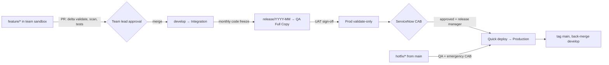

# WM Salesforce DevOps

A reference design and working prototype for releasing Salesforce metadata with **Git + GitHub Actions**,
built for a large org where many teams ship into one production environment.

> **About "WM":** the examples use **Willowmere Waste Co. (WM)**, a fictional waste-services company.
> Team names, users, routes and endpoints are made up. Swap in your own before use.

---

## The problem this solves

Willowmere has 10+ Salesforce teams (5–8 developers each) working in a single org. Before this design:

- every team built in **one shared Dev sandbox**, so changes overwrote each other and merges were painful;
- releases went monthly to **QA (Full Copy)** and then **Production**, with **CAB approval in ServiceNow**;
- pre- and post-deployment steps (permission sets, data loads) were done by hand;
- named credential endpoints differed per environment and were fixed up manually;
- there was **no hotfix path** between monthly releases.

The goal: **any developer can get a change into the pipeline, but nothing reaches Production without the right gates.**

## How it works



| Environment | Branch | Deploys | Gate to move on |
|---|---|---|---|
| Team sandbox | `feature/<team>-<ticket>` | Developer, SF CLI | PR checks + team lead (CODEOWNERS) |
| Integration (the old shared Dev) | `develop` | Automatic on merge | Code freeze by release manager |
| QA (Full Copy) | `release/YYYY-MM`, `hotfix/*` | Automatic on push, with pre/post steps | Regression + UAT sign-off |
| Production | `main` | Quick deploy of a validated package | Prod validation, CAB, release manager approval |

**Key ideas**

- **Delta deploys** with [sfdx-git-delta](https://github.com/scolladon/sfdx-git-delta): only changed metadata is deployed.
- **Merge conflicts surface in Git**, at PR time, instead of as overwrites in a shared org.
- **Per-team test lists** (`tests/manifests/`): each PR runs only the Apex tests for what changed, and fails if a changed class has no test mapped.
- **Environment values as tokens:** named credentials hold `{{ERP_ENDPOINT}}`; the real value comes from the GitHub Environment at deploy time.
- **Pre/post steps as code:** versioned per release, idempotent, logged.
- **CAB as a pipeline gate:** the Production workflow waits for the ServiceNow change to be approved.
- **Hotfix lane** from `main`, with emergency CAB and an automatic back-merge.

## Interactive release flow

Open [`docs/index.html`](docs/index.html) in a browser (download it, or serve the `docs/` folder with GitHub Pages). It has three views:

- **Live release flow:** run the monthly release or hotfix lane gate by gate, and inject a failure at any stage to see the blocker, the workaround and where the change goes back to.
- **State transitions:** a clickable state machine of a change from feature branch to production.
- **Blockers & workarounds:** 14 failure scenarios, filterable by stage and impact.

## Repository layout

```
.github/
  actions/sf-setup/        Shared step: Salesforce CLI, sfdx-git-delta, Code Analyzer, JWT login
  workflows/
    pr-validate.yml        PR → delta build, token replace, static analysis, validate-only + team tests
    deploy-integration.yml Merge to develop → delta deploy to Integration
    nightly-tests.yml      RunLocalTests on Integration every night
    release-qa.yml         Push to release/* or hotfix/* → pre steps, deploy to QA, post steps
    prod-validate.yml      Manual: validate-only against Production, returns a validation ID
    prod-release.yml       Manual: CAB check → env approval → quick deploy → post steps → tag + back-merge
    drift-check.yml        Weekly: diff Production against main
  CODEOWNERS               Team folders → team lead reviewers
config/                    Per-environment values and custom metadata
docs/
  DESIGN.md                Full design, state diagram, risk analysis
  index.html               Interactive release flow
scripts/
  replace-tokens.sh        Fill {{TOKENS}} from environment values; fail if any remain
  select-tests.sh          Pick specified tests for changed files from tests/manifests
  run-release-steps.sh     Run a release's pre/ or post/ steps in order
  servicenow-cab-check.sh  Poll a ServiceNow change until approved
  release/_template/       Example pre/post steps (permission sets, data upsert)
tests/manifests/           Per-team component → test class maps
force-app/                 Salesforce source (empty in this prototype)
```

## Setup

1. **Sandboxes.** One Developer sandbox per team. Turn the old shared Dev into **Integration**: nobody builds there directly.
2. **Connected app** in each org for the JWT bearer flow, with an integration user that can deploy.
3. **GitHub Environments:** `integration`, `qa`, `production-validate`, `production`.
   - Secrets: `SF_CLIENT_ID`, `SF_JWT_KEY`. At repo level: `SN_USER`, `SN_PASSWORD`.
   - Variables: `SF_USERNAME`, `SF_INSTANCE_URL`, `SN_INSTANCE`, and one per named credential token (`ERP_ENDPOINT`, `ROUTING_API_ENDPOINT`, …).
   - On `production`, set **required reviewers** to your release managers.
4. **Branch protection** on `develop`, `release/**` and `main`: PR required, `PR validate` must pass, CODEOWNERS review required, no bypass.
5. Replace the `@willowmere-waste/*` teams in `.github/CODEOWNERS` and fill in `tests/manifests/`.

## Monthly release runbook

1. **Code freeze:** create `release/YYYY-MM` from `develop`. Copy `scripts/release/_template` to `scripts/release/YYYY-MM` and edit the steps.
2. **QA:** `Release to QA` runs on push. Fix defects on the release branch.
3. **Validate:** after UAT sign-off, run **Production validate (check only)** with the branch. Note the validation ID (valid for 10 days).
4. **CAB:** raise or update the ServiceNow change and get it approved.
5. **Release:** run **Production release** with the branch, validation ID and CHG number. A release manager approves the `production` environment.
6. **Close:** the workflow merges to `main`, tags `release-YYYY-MM`, and opens the back-merge PR into `develop`.

**Hotfix:** branch `hotfix/<ticket>` from `main` → PR (team lead) → QA deploys automatically → QA sign-off → emergency CAB → steps 3 to 6 with the hotfix branch.

## What can go wrong

The full list, with detection and workarounds, is in [`docs/DESIGN.md`](docs/DESIGN.md#12-negative-analysis--blockers-and-workarounds). The big ones:

| Risk | Workaround |
|---|---|
| Two teams change the same object or flow | Rebase on `develop` daily; shared objects have a cross-team owner group |
| Passes in Integration, fails in Production | Validate against Production a week early; refresh QA from Production each cycle |
| Apex tests fail in Production | Fix forward on the release branch, or revert that PR and ship the rest |
| Production deploy causes an incident | Salesforce has no automatic rollback: redeploy the previous `main` tag, or use the hotfix lane |
| Someone changes Production by hand | Weekly drift check opens the gap; bring the change back through a PR |

## Status

Design and prototype. The workflows parse and follow current Salesforce CLI (`sf`) commands, but have not been run against a real org. Test them on a sandbox first.
