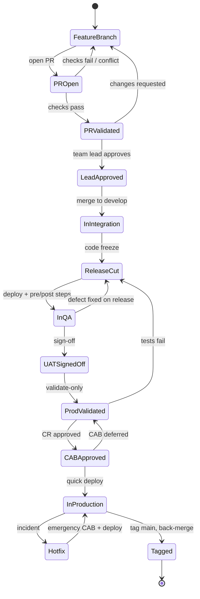

# WM Salesforce DevOps — Design

## 1. Goals
- Stop merge collisions between 10+ teams (5–8 developers each) working in one org.
- Any developer can get a change into the pipeline; promotion to QA and Production stays controlled (team-lead approvals, CAB).
- Automate deployments, tests, per-environment config, and pre/post steps with GitHub Actions. Flosum stays optional (limited licences).

## 2. Current state
- One Git repo; GitHub Actions deployments.
- Environments: one shared Dev sandbox (all teams) → one QA Full Copy → one Production org.
- Metadata: flows, fields, Apex, LWC, Aura, integrations, named credentials, templates, layouts, record pages.
- Monthly release; CAB in ServiceNow; specified Apex tests in Prod; no hotfix path.
- Main pain point: code merges and overwrites in the shared Dev sandbox.

## 3. Target environments
| Environment | Type | Purpose | Deployed from |
|---|---|---|---|
| Team sandboxes (one per team) | Developer / Dev Pro | Build and unit test, isolated | Developer via SF CLI |
| Integration (current shared Dev) | Dev Pro | Integrate all teams; no direct building | `develop`, automatic |
| QA | Full Copy | Regression, UAT, release rehearsal | `release/*`, `hotfix/*` |
| Production | Prod | Live | `main` after CAB |

## 4. Branching
- `main` = Production. Merged only by the release workflow.
- `develop` = Integration, auto-deployed.
- `feature/<team>-<ticket>` from `develop`.
- `release/YYYY-MM` from `develop` at code freeze → QA. Fixes only.
- `hotfix/<ticket>` from `main` → back-merged to `main`, `develop` and open `release/*`.
- CODEOWNERS routes each team's folders to its lead; shared objects (Account, Case, profiles) to a cross-team group.

## 5. Pipeline stages and gates
| # | Stage | Automated gates | Human gate |
|---|---|---|---|
| 1 | Develop (team sandbox) | local tests | — |
| 2 | Pull request → develop | delta build, Code Analyzer, validate-only vs Integration, team tests | Team lead (CODEOWNERS) |
| 3 | Integration | delta deploy, smoke, nightly RunLocalTests | — |
| 4 | Release cut → QA | pre steps, token replace, deploy, post steps | Regression + UAT sign-off |
| 5 | Prod validation | validate-only, RunSpecifiedTests | Release manager |
| 6 | CAB | ServiceNow change approved | CAB + GitHub `production` approval |
| 7 | Production | quick deploy, post steps, smoke, tag + back-merge | — |

## 6. State transitions of a change

## 7. Per-environment config and secrets
- Named credentials hold tokens such as `{{ERP_ENDPOINT}}`; values live in GitHub Environment variables/secrets.
- `scripts/replace-tokens.sh` fills them and fails the build if any token is left.
- Custom metadata per environment in `config/qa`, `config/prod`; custom settings values as post-deploy data loads.
- Credential secrets set after deploy by a post step, or by a Prod admin where policy requires.

## 8. Pre/post steps as code
- `scripts/release/YYYY-MM/pre|post/`, reviewed in PRs, run in file-name order by `scripts/run-release-steps.sh`.
- Pre: field prerequisites, permission set assignment. Post: data loads (upsert on external IDs), permission set and group assignment, custom settings.
- Every step is idempotent and logs to a pipeline artifact.

## 9. Tests
- `tests/manifests/<team>.txt` maps component globs to test classes; `scripts/select-tests.sh` picks the union for changed files.
- A changed Apex class with no mapped test fails the PR.
- Nightly RunLocalTests on Integration; 75% org-wide, 85% target on new code.

## 10. Hotfix lane
`hotfix/*` from `main` → PR (lead) → QA deploy + sign-off → emergency CAB → Prod validate + quick deploy → back-merge to `develop` and `release/*`.

## 11. Roles
- Developers: branches, PRs, own team sandbox.
- Team leads: approve PRs in their folders; approve release merges.
- Release manager: cuts releases, runs Prod validation, approves the `production` environment, coordinates CAB.

## 12. Negative analysis — blockers and workarounds
| # | What goes wrong | Impact | Detection | Workaround |
|---|---|---|---|---|
| 1 | Two teams change the same object/flow/profile | PR blocked, overwrite risk | PR conflict; CODEOWNERS | Rebase daily; decomposed source; shared-object owners |
| 2 | Passes in Integration, fails in QA/Prod (missing dependency) | Release slips | Early validate-only | Validate a week early; refresh QA each cycle; package.xml override |
| 3 | Apex tests fail / coverage < 75% in Prod | Deploy rejected | RunSpecifiedTests | Fix forward on release, or revert that PR and ship the rest |
| 4 | Manifest misses a test class | Untested code / coverage fail | Nightly RunLocalTests | PR fails on unmapped class; leads review manifests |
| 5 | Manual change in QA/Prod | Drift, overwrites | Weekly drift workflow | Restrict Modify Metadata; drift → PR |
| 6 | Named credential token wrong or missing | Integrations break | Post-deploy smoke | Script fails on leftover tokens; values per environment |
| 7 | Pre/post step fails halfway | Partial release | Exit codes, logs | Idempotent rerun; upsert; report missing users |
| 8 | CAB late or ServiceNow down | Release waits | CAB poll | Record approved CHG manually; move window |
| 9 | Prod deploy fails / incident after go-live | Business impact | Smoke tests, monitoring | Redeploy previous tag, or hotfix; feature flags in custom metadata |
| 10 | Destructive changes break dependencies | Fail / data loss | Validate with destructive manifest | Two-release deletes; back up data |
| 11 | Not enough sandbox licences | Teams keep sharing | Licence review | Pair small teams; scratch orgs; refresh rota |
| 12 | Long or queued deploys, org locks | Window overruns | Deploy status | Quick deploy; off-hours; freeze other deploys |
| 13 | Auth expires | All pipelines fail | Login step | JWT + cert, scheduled rotation, alert |
| 14 | Direct push to `develop` | Unreviewed changes | Branch protection | Protection with no bypass |

## 13. Rollout
1. Provision team sandboxes; stop direct building in shared Dev.
2. Branch protection, CODEOWNERS, PR validation.
3. Tokenise named credentials; move values to GitHub Environments.
4. Script the next release's pre/post steps.
5. ServiceNow CAB integration and hotfix lane; pilot with two teams, then everyone.

Interactive version: open `docs/index.html`.
